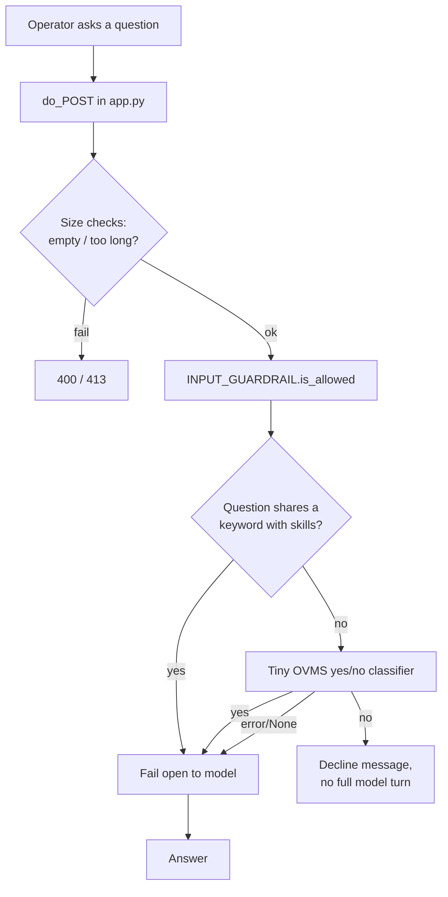

# Scope Guardrail (Pre-Model Gate)

How the QSR operator agent decides whether an operator question is in scope
*before* spending a full model turn, and declines out-of-scope questions with a
fixed message.

## Why
Every operator question is sent to the local Qwen model through OVMS. Without a
gate, off-topic questions (general knowledge, math, trivia) are answered by the
model from its own knowledge. The scope gate blocks those *before* the full
agent turn, and keeps the behavior service-agnostic so new services do not
require code changes.

## Layers
There are two complementary guardrails:

1. **Prompt backstop** — `HERMES_RESPONSE_STYLE` in `operator-ui/app.py` is
   appended to every question and instructs the model to decline unrelated
   questions. This is model-enforced and not guaranteed on a small model.
2. **Pre-model scope gate** — `autonomy/input_guardrail.py` decides scope before the
   full turn. This is the deterministic-leaning layer described below.

## Components
- `autonomy/input_guardrail.py` — gate logic (keyword derivation, classifier, decision).
- `operator-ui/app.py` — builds the gate at startup and calls it in `do_POST`
  before invoking the model.

## Flow


## How each step works

### 1. Build scope terms at startup
`build_input_guardrail()` reads every `qsr-skills/*/SKILL.md` and extracts words from
the frontmatter `name`, `description`, and `tags`. These become the in-scope
keyword set (for example: `menu`, `queue`, `accuracy`, `weather`, `kitchen`,
`station`). Because the terms come from the skill files, **adding a new service
widens scope automatically** with no code change.

### 2. Keyword fast-path (no model call)
`InputGuardrail.is_allowed()` tokenizes the question and checks for overlap with the
skill terms. A hit (for example "how deep is the kiosk **queue**?") is allowed
immediately and goes straight to the model — no classifier, no added latency.

### 3. Classifier fallback (tiny model call)
If there is no keyword overlap (for example "what is the capital of India?"),
the gate calls a minimal OVMS yes/no classifier (`max_tokens=1`, thinking
disabled), built by `build_ovms_classifier()`:
- **no** → the question is declined before the full agent turn.
- **yes** → allowed (handles paraphrases like "is it busy at the counter?" that
  have no exact keyword).

### 4. Fail open on error
If OVMS is unreachable or the reply cannot be parsed, the classifier returns
`None` and the gate **allows** the question through, so a gate outage never
blocks legitimate store operations. The prompt backstop still applies.

### 5. Integration point
In `do_POST`, after the size checks and before the model call: if the gate
returns not-allowed, the handler returns the fixed decline message — JSON for
`/ask`, or a one-shot Server-Sent Event for `/ask/stream`.

## Decline message
```
I can only help with questions about this store's connected services.
```

## Configuration
| Variable | Default | Purpose |
|---|---|---|
| `QSR_SCOPE_GATE` | `true` | Set `false` to disable the gate (allow everything). |
| `QSR_SCOPE_GATE_TIMEOUT` | `15` | Classifier request timeout, seconds. |
| `QSR_ADVISOR_BASE_URL` | `http://127.0.0.1:4444/v3` | OVMS endpoint used by the classifier. |
| `QSR_ADVISOR_MODEL` | `OpenVINO/Qwen3-8B-int4-ov` | Classifier model. |
| `QSR_ADVISOR_API_KEY` | `local-ovms-no-auth` | OVMS auth placeholder. |

Restart the operator UI after changing any of these.

## Behavior examples
| Question | Path | Result |
|---|---|---|
| "How deep is the kiosk queue?" | keyword match | Sent to model |
| "What is our order accuracy rate?" | keyword match | Sent to model |
| "Is it busy at the counter?" | classifier: yes | Sent to model |
| "What is the capital of India?" | classifier: no | Declined before model |
| any, OVMS gate down | fail open | Sent to model (prompt backstop applies) |

## Trade-offs
- The gate is model-assisted for ambiguous questions: off-topic questions cost
  one small OVMS round-trip rather than a full tool-using turn. A purely
  zero-model gate would require keyword-only blocking, which false-rejects valid
  paraphrases, so it was intentionally avoided.
- Keyword overlap is intentionally permissive: a borderline question reaches the
  model, where the prompt backstop still declines unrelated content.

## Tests
`tests/autonomy/test_input_guardrail.py` covers:
- term extraction from installed skills,
- keyword fast-path (classifier not called),
- classifier block / allow,
- fail-open on classifier error,
- disable flag,
- HTTP-level decline before the model.

Run:
```bash
python -m pytest tests/autonomy/test_input_guardrail.py -v
```
