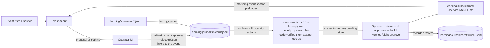

# Operator-Taught Learning

[Documentation guide](index.md) | [Autonomous decisions](autonomy.md) |
[Architecture](architecture.md) | [Integrate a service](self-learning-integration.md)

Hermes learns what operators actually do after an event and, next time the same
kind of event arrives, proposes it for approval. Nothing is hardcoded per event:
every service event, every operator response, and every learned rule go through
the same pipeline. The kiosk queue example below is the reference scenario;
menu availability stays in the hand-written `event-menu-decisions` skill.



## Where Things Live

| Path | Contents | In git |
|---|---|---|
| `learning/simulated/kiosk-queue-history.jsonl` | Simulated historic events with the operator's response | Yes (deterministic) |
| `learning/journal/unlearnt.jsonl` | Records waiting to be learnt: imported simulated history plus live captures | No |
| `learning/journal/learnt/<run>.jsonl` | Records consumed by an approved run, tagged with the skill hash | No |
| `learning/runs/<run>.json` | Learner run: service, record IDs, skill hash before, pending write IDs, status | No |
| `learning/skills/learned-<service>/SKILL.md` | Approved learned skills, one per event-emitting service; each store learns its own | No |
| `~/.hermes/profiles/qsr-learner/` | Learner Hermes profile; staged writes in `pending/skills/`. Created on first **Learn now** or by `learn.py setup` | No |

Set `QSR_LEARNING_DIR` to move `learning/`. In Docker Compose it is the
`learning` named volume, seeded from the image on first start. The learner
profile lives in the container's Hermes home and is recreated on first use;
a skill change still waiting for approval when the container is recreated is
dropped, and its records stay unlearnt for the next run.

Hand-written skills stay in `qsr-skills/` (read-only in Compose). Learned skills
live in `learning/skills/` so the learner can never edit hand-written guidance.

## Record Format

Simulated and live records are identical except for `source`:

```json
{"id": "j-3f2a...", "source": "live", "ts": "2026-10-21T12:07:00+00:00",
 "event": {"event_id": "queue-1a2b", "type": "queue_count_changed", "service": "kiosk",
           "occurred_at": "...", "payload": {"queue_count": 12, "previous_queue_count": 6,
                                             "estimated_wait_minutes": 9}},
 "context": {"kiosk.get_kiosk_context": {"operations": {"kiosk_mode": "standard", "active_kiosks": 3}}},
 "agent": {"proposed": null},
 "operator": {"kind": "instruction", "text": "switch kiosks to express, skip customisation",
              "tool_calls": [{"tool": "kiosk.update_kiosk_settings",
                              "arguments": {"mode": "express", "reason": "..."}}],
              "reply": "Kiosks switched to express mode."},
 "link": "explicit"}
```

| `operator.kind` | Captured when | What Hermes learns |
|---|---|---|
| `instruction` | The operator chats while the event banner is shown | What to propose for this kind of event |
| `rejected` | The operator rejects a proposal (optional reason) | Narrow or remove the rule |
| `approved` | The operator approves a proposal | Confirms the rule |
| `none` | No response within the link window (journaled every minute) | Negative evidence: lowers a rule's precision |

`event.service` groups records into one learned skill per service. Event
producers set a top-level `"service"` in the event envelope; events without it
are journaled as `unknown` and never learnt. `tool_calls` come from the
action-tool calls the MCP services logged during the operator's chat turn
(`MCP_LOG_DIR`, default `tests/mcp-services/logs`). Operator text is untrusted
data: it reaches a skill only through the learner, and every skill write needs
approval.

## Live Capture

The operator UI writes records as the operator works:

- **Event banner.** For `QSR_EVENT_LINK_MINUTES` (default 15) after an event,
  the chat shows *Responding to: Queue update (Queue 12 · from 6 · 9 min wait),
  2 min ago ✕*. A message sent while the banner is visible is linked to that
  event, sent to Hermes with the event as context, and journaled. Click ✕ before
  asking unrelated questions; unlinked messages are never journaled. The scope
  gate checks the operator's own text; the linked event only gives the
  classifier context for short instructions such as "back to normal".
- **Reject.** The UI asks *Why reject?*; the optional reason is journaled.
- **Approve.** Journaled automatically.
- **Status line.** The autonomy panel shows how many operator actions are
  waiting to be learnt and skill changes awaiting approval (`GET /learning/status`).

## Learning From the Operator UI

Operators do not need a terminal. When a service has `QSR_LEARN_THRESHOLD`
(default 20) unlearnt operator actions, and at least
`QSR_LEARN_MIN_EVENT_RECORDS` (default 5) for one event type, the autonomy
panel shows a card: *Hermes can learn from 48 kiosk operator actions · Learn now*.

1. **Learn now** runs the learner in the background (`POST /learning/run`);
   the card and a dialog show progress. It takes about a minute on
   Qwen3-30B-A3B; event decisions share the model and may wait briefly.
2. When the skill is staged, the review dialog opens with each rule, its
   evidence (*taught 15× of 15*), and a NEW tag for rules not in the current skill.
3. **Approve skill** calls Hermes's own `/skills approve` handler for the
   learner profile and archives the learnt records
   (`POST /learning/pending/<id>/approve`). **Reject** discards the change and
   keeps the records for the next run. **Later** leaves it staged.

Set `QSR_LEARN_AUTO=true` to start the learner automatically when a service
reaches the threshold; approval stays manual.

| Variable | Default | Purpose |
|---|---|---|
| `QSR_LEARN_THRESHOLD` | `20` | Unlearnt operator actions per service before **Learn now** is offered |
| `QSR_LEARN_MIN_EVENT_RECORDS` | `5` | Operator actions one event type needs to be learnt |
| `QSR_LEARN_AUTO` | `false` | Start the learner automatically at the threshold |
| `QSR_EVENT_LINK_MINUTES` | `15` | How long an event stays linkable from chat |
| `QSR_LEARNING_DIR` | `./learning` | Journal, runs, and learned skills |
| `QSR_LEARNER_PROFILE` / `QSR_LEARNER_HERMES_HOME` | `qsr-learner` / `~/.hermes/profiles/qsr-learner` | Learner Hermes profile; the home must be that profile's directory |
| `QSR_LEARNER_MAX_TOKENS` / `QSR_LEARNER_TIMEOUT` | `2048` / `600` | Learner model call limits |

The learner profile copies the model and provider from `~/.hermes/config.yaml`
when it is created; run `learn.py setup` again after changing the model.
Every minute the UI also archives runs approved interactively in Hermes and
dismisses runs whose staged write was rejected or removed.

## Kiosk Example: Queue Rules

The kiosk service gained `update_kiosk_settings` (one atomic bundle of `mode`,
`active_kiosks`, `upsell_enabled`, like `change_menu_items`) because the event
agent proposes one action per event. Kiosk context now reports `kiosk_mode`,
`active_kiosks`, `max_kiosks`, `upsell_enabled`, and `baseline_settings`.
`kiosk.update_kiosk_settings` is registered in the autonomy catalog but is not
part of any hand-written skill, so the event agent only proposes it once a
learned skill allows it.

The simulator's hidden operator policy (never shown to Hermes) is:

| ID | Condition | Operator says (varied) | Tool call |
|---|---|---|---|
| K1 | queue ≥ 10 or wait ≥ 8 min | "switch kiosks to express, skip customisation" | `mode: express` |
| K2 | wait ≥ 8 min and a kiosk idle | "open kiosk 4" | `active_kiosks: +1` |
| K3 | queue ≥ 8 | "kill the 'add a drink?' screens, they slow the line" | `upsell_enabled: false` |
| K4 | queue < 5 twice in a row | "ok, back to normal" | restore `baseline_settings` |

Noise: about 10% of triggers are ignored and two one-off instructions at a
quiet queue are injected; a good learned skill ignores them.

## Run the Demo (host install)

Use the MCP venv interpreter created by `scripts/setup.sh`:

```bash
PY=.venv/mcp/bin/python
```

1. Create the learner profile (optional: **Learn now** creates it on first
   use). It is an empty Hermes profile that reuses your working model/provider
   settings, keeps skills in `learning/skills/`, turns `skills.write_approval`
   on, and disables MCP servers and memory:

   ```bash
   $PY scripts/learn.py setup
   ```

2. Generate and import simulated history:

   ```bash
   $PY scripts/simulate_kiosk_history.py            # --days 8 --seed 7 by default
   $PY scripts/learn.py import learning/simulated/kiosk-queue-history.jsonl
   $PY scripts/learn.py status
   ```

3. Show the before state. Start the operator UI, then raise the queue; only
   hand-written guidance applies, so expect a menu proposal or no action:

   ```bash
   $PY scripts/queue_event.py --count 12 --wait 9
   ```

4. Run the learner: click **Learn now** on the autonomy panel card, or use the
   CLI below. The learner profile's model proposes candidate rules as
   JSON (one setting per rule); the code checks each rule against the records,
   fits thresholds to the data, drops unsupported or duplicate rules, induces
   rules for operator changes nothing covers, and renders `learned-kiosk`. The
   write is staged in the learner profile's Hermes pending store, not applied.
   Add `--dry-run` to print the prompt without calling the model.

   ```bash
   $PY scripts/learn.py run
   ```

5. Review and approve: in the operator UI (**Review** → **Approve skill**), from
   the CLI, or interactively in Hermes:

   ```bash
   $PY scripts/learn.py pending
   $PY scripts/learn.py approve <id>          # or: reject <id>; both finalize
   ```

   ```text
   hermes -p qsr-learner
   /skills pending
   /skills diff <id>
   /skills approve <id>
   ```

6. After approving interactively in Hermes, the UI archives the learnt records
   within a minute; without the UI, run:

   ```bash
   $PY scripts/learn.py finalize
   ```

7. Replay the condition. The event agent preloads the
   `## event: queue_count_changed` section of `learned-kiosk` and proposes the
   learned settings bundle for approval; recovery proposes the baseline:

   ```bash
   $PY scripts/queue_event.py --count 12 --wait 9
   $PY scripts/queue_event.py --count 3 --wait 2
   $PY scripts/queue_event.py --count 2 --wait 1
   ```

Leave `QSR_QUEUE_COUNT` and `QSR_ESTIMATED_WAIT_MINUTES` unset; they override
the queue state that `queue_event.py` writes.

## Run the Demo (Docker Compose)

```bash
make learn ARGS="import learning/simulated/kiosk-queue-history.jsonl"
# Operator UI: Learn now -> Review -> Approve skill. CLI alternative:
make learn ARGS=run
make learn ARGS="approve <id>"
make queue COUNT=12 WAIT=9
```

## Live Learning Loop

Once simulated history is learnt, live operation feeds the same journal:

1. A queue event arrives and the banner appears.
2. The operator types what to do (or rejects a proposal with a reason).
3. Records accumulate in `unlearnt.jsonl`. At the threshold the autonomy panel
   offers **Learn now** (or `learn.py status` shows ready event types).
4. The learner patches only that service's skill; the operator reviews and
   approves it in the UI (or with `learn.py approve`).

A rejected run is marked `dismissed`; its records stay unlearnt and are
included in the next run. Only one staged run per service is allowed at a time.

## Learned Skill Format

Generated from verified rules (counts come from the records, never from the model):

````markdown
---
name: learned-kiosk
description: "Operator-taught responses to kiosk service events."
metadata:
  qsr:
    service: kiosk
    events: [queue_count_changed]
    tools: [kiosk.get_kiosk_context, kiosk.update_kiosk_settings]
---
# Learned: kiosk

## event: queue_count_changed
- When context[kiosk.get_kiosk_context].operations.kiosk_mode == "standard" and
  event.queue_count >= 10 -> propose kiosk.update_kiosk_settings with mode="express"
  (taught 14x of 14 matching events, rejected 0x)
- ...

Machine-readable rules:
```json
[{"when": [...], "propose": {"tool": "kiosk.update_kiosk_settings", "set": {"mode": "express"}}}]
```
````

At each event the autonomy worker rescans `learning/skills/learned-*/SKILL.md`.
A skill is registered only if every listed tool is registered and each action's
required reads are listed; otherwise it is skipped with a log line. Only the
section matching the event type is loaded into the prompt, so one skill per
service stays cheap as it grows.

After the context reads, the event agent evaluates the machine-readable rules
against the event and live context itself and gives the model the combined
settings of every matching rule. The model decides whether to act and writes
the reason; matched settings it leaves out are added to the proposal (recorded
as `learned_settings` in the evidence) when the owner validator accepts them.
If the model proposes no action but a learned rule matches, the agent proposes
the matched settings itself (the model's reasoning is kept as `model_summary`);
the owner validator and operator approval still apply.

## Safety Rules

- The event agent never writes skills; only the learner profile does, and
  `skills.write_approval` stages every write for operator review.
- Learned rules can only reference catalog tools; owner validators, fresh
  context, and operator approval still gate every proposal.
- Records and operator text are treated as untrusted data in the learner prompt.
- Learned skills cannot touch `qsr-skills/`.

## Limitations

- Hermes hides `skill_manage` in one-shot (`-z`/`-q`) runs, so the learner calls
  the profile's model endpoint directly and writes the staged record into the
  profile's `pending/skills/` itself; approval still uses Hermes `/skills approve`.
- UI and CLI approval call Hermes's internal `/skills` handler (located with
  `hermes --print-runtime-command`); re-test approval after upgrading Hermes.
- One learner run at a time, on the same model as event decisions; events
  queue behind it for about a minute.
- One action per event: if both menu and kiosk-settings guidance apply, the
  agent proposes one of them.
- Editing a proposal before approval is not captured; reject with a reason and
  type the intended instruction instead.
- Chat `tool_calls` are read from service logs by time window; a concurrent
  approval in the same window can be attributed to the chat turn.
- Chat runs in one always-on Hermes conversation, but a chat instruction must
  still be explicit (the kiosk skill treats direct settings instructions as
  approval).

---

[Documentation guide](index.md) | [Autonomous decisions](autonomy.md)
