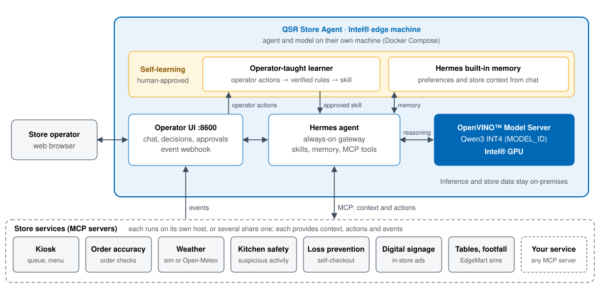

# QSR Store Agent

The QSR Store Agent is an AI operations assistant for quick-service restaurants
(QSR). It runs entirely on an Intel® edge system in the store. Restaurant staff
ask questions in plain language and get answers built from live store data. The
agent also watches store events, such as a weather change, a long queue, or an
order mistake, and proposes actions that a manager approves before anything
changes.

Inference runs locally with the OpenVINO™ Model Server on an Intel® GPU, so
store data, conversations, and decisions never leave the premises.

## What It Does

| Capability | Description |
|---|---|
| Operator chat | Ask about queues, wait times, menu availability, order accuracy, kitchen safety, tables, footfall, signage, and weather. Answers come from the connected store services, not from the model's memory. |
| Event-driven recommendations | Store systems post events to the agent. The agent gathers the relevant live context and either proposes an action or explains why no action is needed. |
| Human approval | Every proposed action waits for an operator to approve or reject it in the UI. Nothing changes in the store without approval. |
| Learning from operators | The agent records how operators respond to events and, after review, turns repeated responses into new guidance for future events. |
| Pluggable store services | Each store system (kiosk, order accuracy, signage, and more) connects through the open Model Context Protocol (MCP). Systems can run on the same machine or elsewhere on the store network. |
| Scope guardrail | Questions unrelated to the store are declined before they reach the language model. |

## Why Run It on Intel Hardware

- **Local, private inference.** A Qwen3 INT4 model (set by `MODEL_ID`, default
  Qwen3-30B-A3B) is served by the OpenVINO™ Model Server on the store's
  Intel® GPU. No cloud dependency or per-request cost.
- **Optimized with OpenVINO™.** The model is pre-converted and INT4-compressed
  for Intel GPUs. Prefix caching reuses the shared prompt between requests to
  reduce response latency.
- **One edge system.** The model server, agent, operator UI, and demo services
  run as containers on a single Intel-based machine.

## What Is Included

- The operator web UI and the agent runtime, packaged as one container image.
- The OpenVINO™ Model Server configuration for the local language model.
- A weather service that can simulate conditions for demos or report live
  weather.
- Simulated kiosk and order-accuracy services that show how real store systems
  plug in.
- Connection settings for other store services, such as kitchen safety, digital
  signage, and EdgeMart table and footfall simulators, when they are deployed.

> The included kiosk, order-accuracy, and weather data are simulated. Connect
> your own store systems for production use.

## Documentation

- [Get Started](get-started.md): install and run the agent.
  - [System Requirements](get-started/system-requirements.md)
  - [Configuration](get-started/configuration.md)
  - [Build from Source](get-started/build-from-source.md)
- [How It Works](how-it-works.md): architecture and data flow.
- [Operator Guide](operator-guide.md): use the chat, approve decisions, and
  teach the agent.
- [API Reference](api-reference.md): HTTP endpoints of the operator UI.
- [Troubleshooting](troubleshooting.md)
- [Release Notes](release-notes.md)
